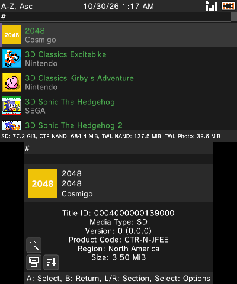

# ftb

[FBI](https://github.com/Steveice10/FBI) with added features. 3ds title manager, FTP server, and more.

## Download
<table>
  <tr>
    <th>CIA QR Code (Remote Install)</th>
  </tr>
  <tr>
    <td align="center"></td>
  </tr>
</table>

<!-- Quick Reference -->
<table border="0">
<tbody>
<tr>
<td valign="top"></td>
<td valign="top"></td>
<td valign="top"></td>
<td valign="top"></td>
</tr>
</tbody>
</table>
<!-- End Quick Reference -->

## Features

- **[CIA Installer](https://github.com/fosterbarnes/ftb/wiki/CIA-Installer):** Quickly scans given folder(s) for .cia files then presents them all in one list. Configure the folder(s) to scan once, then quickly jump in and install something next time.
- **[Title Manager](https://github.com/fosterbarnes/ftb/wiki/Title-Manager):** All new layouts and UI. Icon grid, list, or icon list. Sorting options, section jumps, and a title cache that makes opening the full list pretty quick.
- **[FTP Server](https://github.com/fosterbarnes/ftb/wiki/FTP-Server):** Easily transfer files to and from the SD card without leaving the app.
- **[3DS Web Server](https://github.com/fosterbarnes/ftb/wiki/3DS-Web-Server):** Send links, CIAs, and any other files to or from a phone or PC browser (scan the QR code on screen), or download files from the SD card to it. CIAs install straight from the network.
- **[In-app updates](https://github.com/fosterbarnes/ftb/wiki/Install#updating)** Easily update ftb from inside the app. Auto installs and re-launches.

Does not interfere or override any existing FBI installs. This project is in active development. Full docs are in the
[wiki](https://github.com/fosterbarnes/ftb/wiki).

## Screenshots

<table>
  <tr>
    <th>Main Menu</th>
    <th>Title Manager (List)</th>
  </tr>
  <tr>
    <td align="center"></td>
    <td align="center"></td>
  </tr>
  <tr>
    <th>Title Manager (Top)</th>
    <th>Title Manager (Grid)</th>
  </tr>
  <tr>
    <td align="center"></td>
    <td align="center"></td>
  </tr>
  <tr>
    <th>CIA Installer</th>
    <th>SD Browser</th>
  </tr>
  <tr>
    <td align="center"></td>
    <td align="center"></td>
  </tr>
  <tr>
    <th>3DS Web Server</th>
    <th>FTP Server</th>
  </tr>
  <tr>
    <td align="center"></td>
    <td align="center"></td>
  </tr>
  <tr>
    <th>FBI Legacy</th>
    <th>Settings</th>
  </tr>
  <tr>
    <td align="center"></td>
    <td align="center"></td>
  </tr>
</table>

## What is ftb?

An app for modded Nintendo 3DSs that installs and manages game and app titles.
It's a fork of [FBI](https://github.com/Steveice10/FBI), the OG 3DS title manager by
Steveice10. FBI is now an archive and no longer gets updates, so ftb picks up where it left off.
Dark theme by default, attempted improved UI, and completely new features inspired by existing 3DS homebrew apps.

## How it works

- ftb runs on a 3DS with [Luma3DS](https://github.com/LumaTeam/Luma3DS) custom firmware. It installs as its own app, so it sits alongside FBI instead of replacing it.
- It uses the 3DS's own system services to install CIA files (the 3DS install package format),list what is installed, and manage titles, tickets, and save data.
- The 3DS Web Server serves a web page from your console that any phone or PC browser can open by scanning the QR code on
  screen, or entering the link. It lets you browse files, upload/download files, and install CIAs.
- The FTP Server works with any FTP app on a PC, like FileZilla. This menu has feature parity with FTPD.
- Anything that could damage the console, like deleting system titles or writing to NAND (the console's internal storage), stays locked until you turn on System changes in Settings.

## What it's written in

ftb wasn't rewritten in a new language. Like FBI, it's C, built with devkitPro and libctru (the standard 3DS homebrew toolchain). FBI's code was reorganized and extended, and new parts were added:

- **C:** the app itself: screens, installers, the title cache, and the 3DS Web Server server.
- **C++:** the FTP server, ported from [ftpd](https://github.com/mtheall/ftpd) and trimmed to run
  inside ftb.
- **HTML, CSS, JavaScript:** the 3DS Web Server page. It ships inside the app and is served to your
  browser.
- **PowerShell and Python:** build, release, theme art, and 3D banner scripts. These run on a PC,
  never on the console.

## Credit
- **FBI:** [Steveice10](https://github.com/Steveice10/FBI)
- **Original banner:** [OctopusRift](http://gbatemp.net/members/octopusrift.356526/), [Apache Thunder](https://gbatemp.net/members/apache-thunder.105648/), and [PabloMK7](http://gbatemp.net/members/pablomk7.345712/)
- **Original logo:** [PabloMK7](http://gbatemp.net/members/pablomk7.345712/)
- **SPI protocol:** [TuxSH](https://github.com/TuxSH/TWLSaveTool)
- **FTP server:** [ftpd](https://github.com/mtheall/ftpd) by Michael Theall, Dave Murphy, and TuxSH (GPL v3)

## License
ftb binaries are GPL v3. See `LICENSE.txt`.
