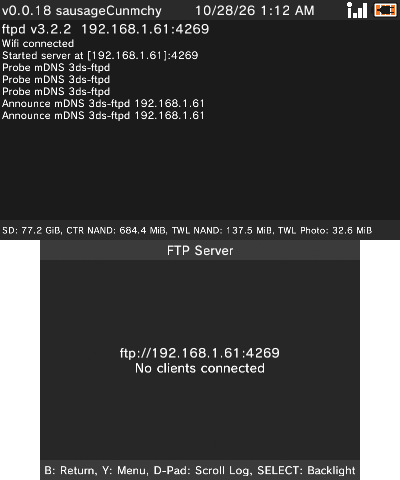
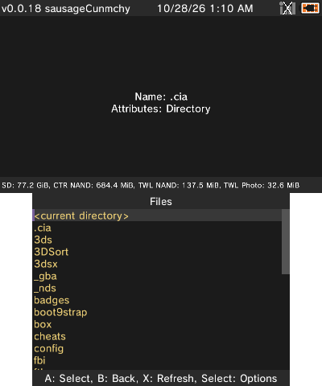

# ftb

[FBI](https://github.com/Steveice10/FBI) with added features. 3ds title manager, FTP server, and more.

## Download
<!-- Quick Reference -->
<table border="0">
<tbody>
<tr>
<td valign="top"></td>
<td valign="top"></td>
<td valign="top"></td>
<td valign="top"></td>
</tr>
</tbody>
</table>
<!-- End Quick Reference -->

## Features

### Built-in FTP server
Transfer files to and from the SD card over Wi-Fi (powered by ftpd).

### New Title Manager
- Loads faster by keeping a cached title list on the SD card.
- Three layouts: Grid, List (top), and List (bottom). The grid has adjustable zoom.
- Seven sort options: Name, Title ID, Size, Publisher, Type, Region, and Game. You can also choose the sort order and group titles by location.
- Show or hide game card, SD, and NAND titles.
- Remembers your layout, sort, and filter choices between launches.

### Redesigned install and download progress
Smooth progress bars with speed and time remaining.

### Dark theme
New icon, banner, and launch screen.

### More coming soon!
This project is in active development.

## Screenshots

<table>
  <tr>
    <th>Home</th>
    <th>Title Manager </th> 
  </tr>
  <tr>
    <td align="center"></td>
    <td align="center"></td>
  </tr>
  <tr>
    <th>FTP Server</th>
    <th>Progress Bar</th>
  </tr>
  <tr>
    <td align="center"></td>
    <td align="center"></td>
  </tr>
  <tr>
    <th colspan="2">SD Browser</th>
  </tr>
  <tr>
    <td colspan="2" align="center"></td>
  </tr>
</table>

## Credit

### FBI
[Steveice10](https://github.com/Steveice10/FBI)

### Original banner
[OctopusRift](http://gbatemp.net/members/octopusrift.356526/), [Apache Thunder](https://gbatemp.net/members/apache-thunder.105648/), and [PabloMK7](http://gbatemp.net/members/pablomk7.345712/)

### Original logo
[PabloMK7](http://gbatemp.net/members/pablomk7.345712/)

### SPI protocol
[TuxSH](https://github.com/TuxSH/TWLSaveTool)

### FTP server
[ftpd](https://github.com/mtheall/ftpd) by Michael Theall, Dave Murphy, and TuxSH (GPL v3)

### License
FTB binaries are GPL v3. See `LICENSE.txt`.
