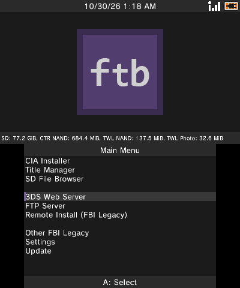
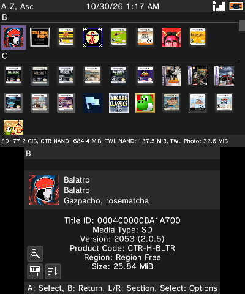
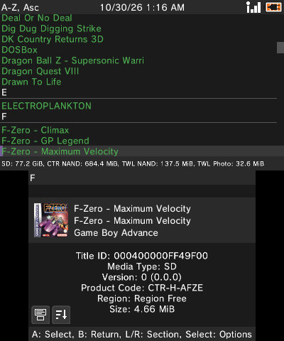
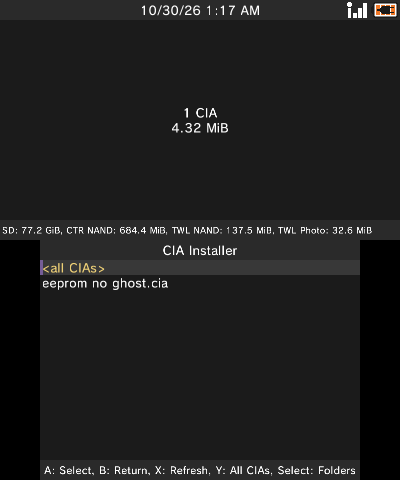
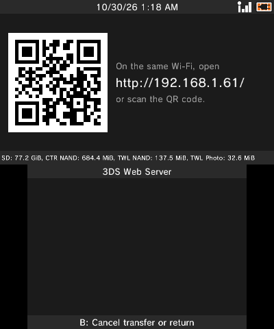
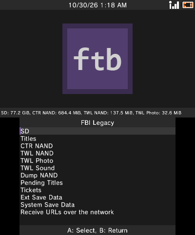
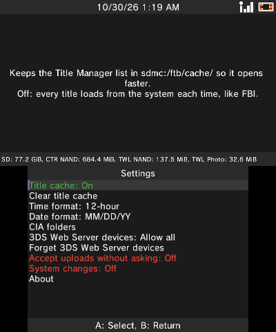

# ftb

A 3DS title manager, CIA installer, FTP server, and more. Built on [FBI](https://github.com/Steveice10/FBI).

## Download

<table>
  <tr>
    <th>CIA QR Code (Remote Install)</th>
  </tr>
  <tr>
    <td align="center"></td>
  </tr>
</table>

<!-- Quick Reference -->
<table border="0">
<tbody>
<tr>
<td valign="top"></td>
<td valign="top"></td>
<td valign="top"></td>
<td valign="top"></td>
</tr>
</tbody>
</table>
<!-- End Quick Reference -->

## Features

- **[CIA Installer](https://github.com/fosterbarnes/ftb/wiki/CIA-Installer):** Scans the folders you choose for .cia files and shows them all in one list. Set the folders once, then install from them anytime.
- **[Title Manager](https://github.com/fosterbarnes/ftb/wiki/Title-Manager):** New layouts: icon grid, list, or icon list. Includes sorting, section jumps, and a title cache so the full list opens fast.
- **[FTP Server](https://github.com/fosterbarnes/ftb/wiki/FTP-Server):** Transfer files to and from the SD card without leaving the app.
- **[3DS Web Server](https://github.com/fosterbarnes/ftb/wiki/3DS-Web-Server):** Scan the on-screen QR code with a phone or PC browser to send links, CIAs, and other files to the 3DS, or download files from its SD card. CIAs install straight over the network.
- **[In-app updates](https://github.com/fosterbarnes/ftb/wiki/Install#updating):** Update ftb from inside the app. It installs the update and relaunches itself.

Installs alongside FBI without changing or replacing it. This project is in active development. Full docs are in the
[wiki](https://github.com/fosterbarnes/ftb/wiki).

## Screenshots

<table>
  <tr>
    <th>Main Menu</th>
    <th>Title Manager (Grid)</th>
  </tr>
  <tr>
    <td align="center"></td>
    <td align="center"></td>
  </tr>
  <tr>
    <th>Title Manager (Icon List)</th>
    <th>Title Manager (List)</th>
  </tr>
  <tr>
    <td align="center"></td>
    <td align="center"></td>
  </tr>
  <tr>
    <th>CIA Installer</th>
    <th>SD Browser</th>
  </tr>
  <tr>
    <td align="center"></td>
    <td align="center"></td>
  </tr>
  <tr>
    <th>3DS Web Server</th>
    <th>FTP Server</th>
  </tr>
  <tr>
    <td align="center"></td>
    <td align="center"></td>
  </tr>
  <tr>
    <th>FBI Legacy</th>
    <th>Settings</th>
  </tr>
  <tr>
    <td align="center"></td>
    <td align="center"></td>
  </tr>
</table>

## Why does this exist?

[FBI](https://github.com/Steveice10/FBI) by Steveice10 was the standard title manager for modded
3DS consoles, but it has been archived and no longer gets updates. ftb is a fork that keeps it
going. It does everything FBI does, and adds a dark theme, a reworked UI, and new features
inspired by other 3DS homebrew apps.

## How it works

- ftb runs on a 3DS with [Luma3DS](https://github.com/LumaTeam/Luma3DS) custom firmware. It installs as its own app, so it sits alongside FBI instead of replacing it.
- It uses the 3DS's own system services to install CIA files (the 3DS install package format), list what is installed, and manage titles, tickets, and save data.
- The 3DS Web Server serves a web page from your console that any phone or PC browser can open by scanning the QR code on
  screen, or entering the link. It lets you browse files, upload/download files, and install CIAs.
- The FTP Server works with any FTP app on a PC, like FileZilla. It's built on ftpd, so it supports the same transfers.
- Anything that could damage the console, like deleting system titles or writing to NAND (the console's internal storage), stays locked until you turn on System changes in Settings.

## Credit
- **FBI:** [Steveice10](https://github.com/Steveice10/FBI)
- **Original banner:** [OctopusRift](http://gbatemp.net/members/octopusrift.356526/), [Apache Thunder](https://gbatemp.net/members/apache-thunder.105648/), and [PabloMK7](http://gbatemp.net/members/pablomk7.345712/)
- **Original logo:** [PabloMK7](http://gbatemp.net/members/pablomk7.345712/)
- **SPI protocol:** [TuxSH](https://github.com/TuxSH/TWLSaveTool)
- **FTP server:** [ftpd](https://github.com/mtheall/ftpd) by Michael Theall, Dave Murphy, and TuxSH (GPL v3)

## License
ftb binaries are GPL v3. See `LICENSE.txt`.
