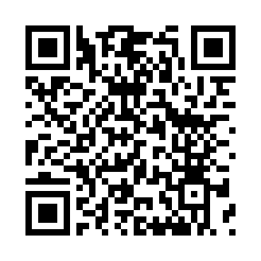
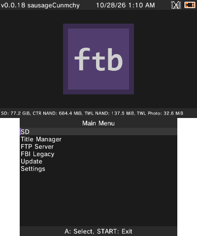
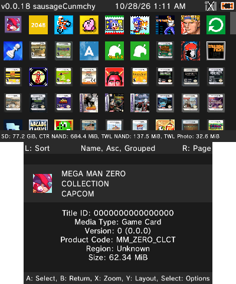
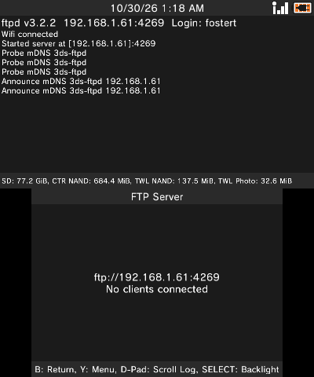
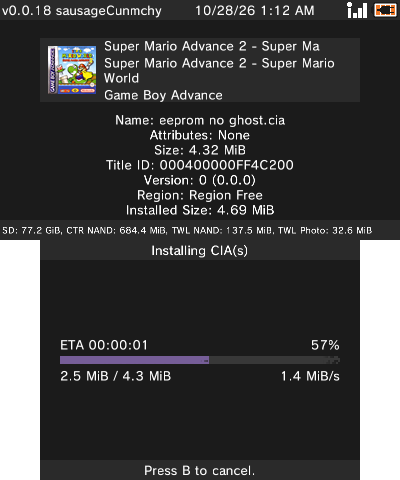
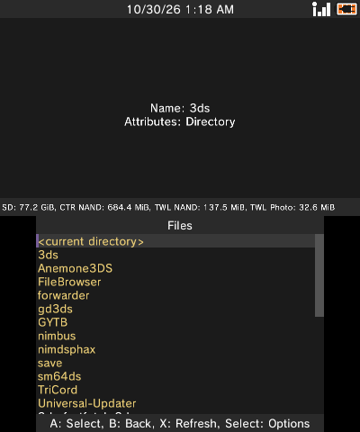

# ftb

[FBI](https://github.com/Steveice10/FBI) with added features. 3ds title manager, FTP server, and more.

## Download
<table>
  <tr>
    <th>CIA QR Code (Remote Install)</th>
  </tr>
  <tr>
    <td align="center"></td>
  </tr>
</table>

<!-- Quick Reference -->
<table border="0">
<tbody>
<tr>
<td valign="top"></td>
<td valign="top"></td>
<td valign="top"></td>
<td valign="top"></td>
</tr>
</tbody>
</table>
<!-- End Quick Reference -->

## Features

- **[CIA Installer](https://github.com/fosterbarnes/FTB/wiki/CIA-Installer):** Quickly scans given folder(s) for .cia files. Faster than manually browsing to your .cia files under the old 'SD' menu.
- **[Title Manager](https://github.com/fosterbarnes/FTB/wiki/Title-Manager):** All new layouts and UI. Icon grid, list, or icon list. Sorting options, section jumps, and a title cache that makes opening the full list pretty quick.
- **[FTP Server](https://github.com/fosterbarnes/FTB/wiki/FTP-Server):** Easily transfer files to and from the SD card without leaving the app.
- **[3DS Web Server](https://github.com/fosterbarnes/FTB/wiki/3DS-Web-Server):** Send links, CIAs, and any other files from a phone or PC browser (scan the QR code on screen), or download files from the SD card to it. CIAs install straight from the network.
- **[Remote Install](https://github.com/fosterbarnes/FTB/wiki/Remote-Install):** Install from a URL or a QR code. (Same as OG FBI at the moment)
- **[Themes](https://github.com/fosterbarnes/FTB/wiki/Theming):** Dark by default; FBI themes are supported.
- **[In-app updates](https://github.com/fosterbarnes/FTB/wiki/Install#updating)** Easily update ftb from inside the app. Auto installs and re-launches.

Does not interfere or override any existing FBI installs. This project is in active development. Full docs are in the
[wiki](https://github.com/fosterbarnes/FTB/wiki).

## Screenshots

<table>
  <tr>
    <th>Home</th>
    <th>Title Manager </th> 
  </tr>
  <tr>
    <td align="center"></td>
    <td align="center"></td>
  </tr>
  <tr>
    <th>FTP Server</th>
    <th>Progress Bar</th>
  </tr>
  <tr>
    <td align="center"></td>
    <td align="center"></td>
  </tr>
  <tr>
    <th colspan="2">SD Browser</th>
  </tr>
  <tr>
    <td colspan="2" align="center"></td>
  </tr>
</table>

## What is FTB?

FTB is an app for a modded Nintendo 3DS that installs and manages games and apps ("titles").
It is a fork of [FBI](https://github.com/Steveice10/FBI), the long-time 3DS title manager by
Steveice10. FBI is now an archive and no longer gets updates, so FTB picks up where it left off:
a dark look, faster screens, and new ways to get files onto the console.

## How it works

- FTB runs on a 3DS with [Luma3DS](https://github.com/LumaTeam/Luma3DS) custom firmware. It
  installs as its own app, so it sits next to FBI instead of replacing it.
- It uses the 3DS's own system services to install CIA files (the 3DS install package format),
  list what is installed, and manage titles, tickets, and save data.
- The Wi-Fi features run a small server on the console. FTP Server works with any FTP app on a PC.
  3DS Web Server serves a web page that any phone or PC browser can open by scanning the QR code on
  screen.
- Anything that could damage the console, like deleting system titles or writing to NAND (the
  console's internal storage), stays locked until you turn on System changes in Settings.

## What it's written in

FTB wasn't rewritten in a new language. Like FBI, it's C, built with devkitPro and libctru (the
standard 3DS homebrew toolchain). FBI's code was reorganized and extended, and new parts were added:

- **C:** the app itself: screens, installers, the title cache, and the 3DS Web Server server.
- **C++:** the FTP server, ported from [ftpd](https://github.com/mtheall/ftpd) and trimmed to run
  inside FTB.
- **HTML, CSS, JavaScript:** the 3DS Web Server page. It ships inside the app and is served to your
  browser.
- **PowerShell and Python:** build, release, theme art, and 3D banner scripts. These run on a PC,
  never on the console.

## Credit
- **FBI:** [Steveice10](https://github.com/Steveice10/FBI)
- **Original banner:** [OctopusRift](http://gbatemp.net/members/octopusrift.356526/), [Apache Thunder](https://gbatemp.net/members/apache-thunder.105648/), and [PabloMK7](http://gbatemp.net/members/pablomk7.345712/)
- **Original logo:** [PabloMK7](http://gbatemp.net/members/pablomk7.345712/)
- **SPI protocol:** [TuxSH](https://github.com/TuxSH/TWLSaveTool)
- **FTP server:** [ftpd](https://github.com/mtheall/ftpd) by Michael Theall, Dave Murphy, and TuxSH (GPL v3)

## License
FTB binaries are GPL v3. See `LICENSE.txt`.
